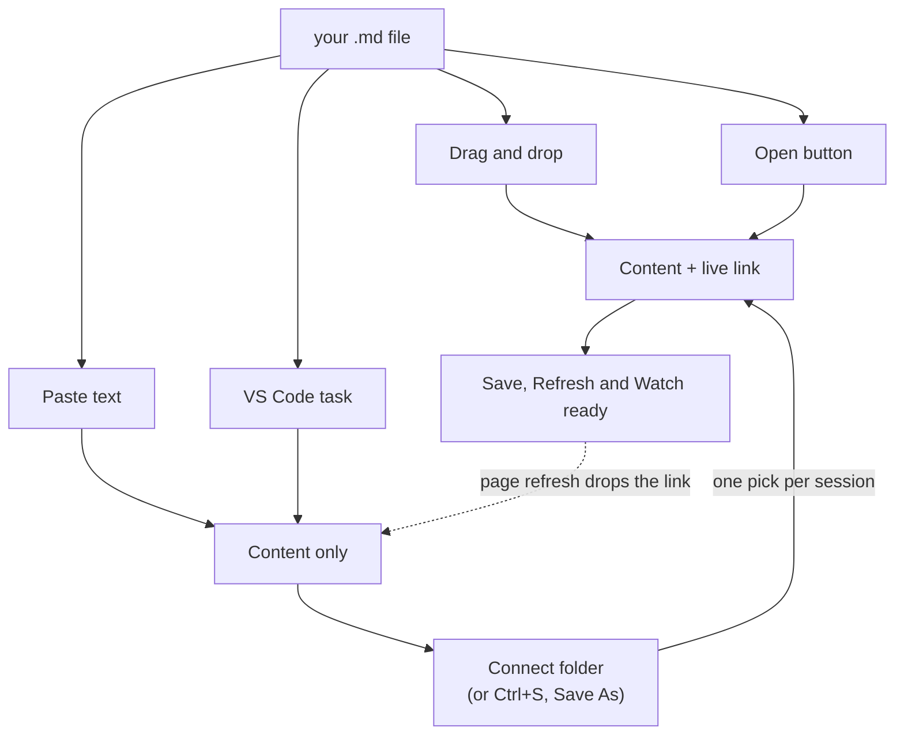

# Northern Lights MD Viewer

*The most beautiful Markdown viewer — and an editor that keeps your files exactly as you
wrote them. One HTML file, ~270 KB, nothing to install.*

**Every other Markdown viewer is built to render the file. This one is built so you
can read it.**

None of them seem concerned with your eyes — whether the type is a size you can
comfortably take in, whether the contrast suits the room you're sitting in, whether
you can shape the page the way *you* want. They render correctly and consider the job
done.

And you're stuck with whichever one you've got: the preview pane bolted into your
editor, the renderer on a website, the viewer inside your notes app. Each hands you
one fixed appearance, a fraction of the capabilities you actually want, and no say in
either.

## Made for reading

**Text that scales without the page falling apart.** Most viewers give you one size
and a zoom that enlarges the entire interface — the toolbar grows along with the text,
the layout reflows, tables break, and you end up with *fewer* words on screen than you
started with. This scales the **document**, 65% to 260%, and leaves the furniture
alone. More words, same layout, nothing rearranged.

**Contrast you choose.** Twelve palettes across light and dark, every one
contrast-validated rather than eyeballed: body text holds 12:1 or better in all
twelve. **Bold all** thickens the body text for glare and low-contrast screens. Dark
mode dims images, so a white-background screenshot stops being a flashbulb.

**It remembers.** Size, palette, layout and your open documents persist between
sessions, and the page opens already themed instead of flashing white and correcting
itself.

## Made for working

**Keep your editor — use this as the preview.** Turn on **Watch** and the viewer
re-reads the file every time you save. Write wherever you like, on one half of the
screen, and see the formatting land in a reader set up for your eyes. *(Chromium
browsers — elsewhere the buttons simply aren't there and everything else works.)*

**Or edit right here.** Press **✎ Edit** (`Ctrl+E`) and click any paragraph, list,
table or code block: it turns into its own Markdown, in place. Click away and it
renders again — and saves to the file. Only the lines of that block change; the rest
of the file, its formatting and its line endings come through byte for byte, so your
git diff shows exactly what you edited and nothing else.

The pencils in the contents sidebar do the same for a whole section: the page scrolls
there, the section is framed in red, and the frame follows you as you edit your way
through the document. Want to see what's underneath? The **‹/› Markdown** icon on the
block you're editing opens a read-only pane with its source, line numbers and all.

**Find, and replace.** `Ctrl+F` highlights every match, with a count and ticks beside the
scrollbar — and unlike the browser's own find, it looks inside collapsed sections.
`Ctrl+H` replaces, and it works on the Markdown source, never the rendered text, so it
can't damage formatting. Each replace saves to the file and can be undone like any edit.

**Every file you open is a tab,** and the tabs survive a refresh and come back the next
day. Click **📁 Connect folder**, pick your project folder once, and every tab is linked
to its file again — saving straight to disk, Watch working, relative images loading.

The first time an edit is saved, the browser asks once whether this page may edit the
file. Allow it and every save after that goes straight to disk — no dialog. With no file
to write to (pasted text, or a file from VS Code before you connect its folder),
`Ctrl+S` asks where to save. A file that changed on disk underneath you is reported,
never silently overwritten.

## Markdown in, HTML out

Reading is half of it. The other half is turning the document into something you can
send to anyone.

**Export** writes a single self-contained `.html` file. Every style is inlined — the
palette you picked, your text size, bold-all, image dimming — so it opens looking
exactly like what was on your screen, in any browser, with no stylesheet, no font and
no script to fetch. Mermaid diagrams travel as already-rendered SVG, so they appear
for someone who has never heard of Mermaid. The copy buttons are stripped.

**There are no `<script>` tags in the output at all.** That matters more than it
sounds: the result can be emailed, dropped into a wiki or SharePoint, or opened on a
machine with scripting locked down, and it still renders exactly the same.

`Ctrl+P` gives you a PDF instead. Printing reverts to 11pt on white whatever theme you
were reading in, so the page reads properly on paper rather than emerging as a dark
rectangle.

And all of it happens on your machine. Converting Markdown to HTML normally means
installing a toolchain or pasting your document into somebody's website — which stops
being an option the moment the content is confidential. Nothing here leaves the
browser.

## Nothing to install, nothing to approve

No install. No server. No build step, no toolchain, no `node_modules`. **Nothing in
the package is executable** — no installer, no script, no launcher — so there is
nothing for a mail gateway to strip, SmartScreen to warn about, or policy to block,
and nothing to raise a ticket for. The people who most need a readable Markdown viewer
are often exactly the people who can't get one approved.

Download the folder, double-click the HTML file, drop a `.md` on it. Bookmark it to
your toolbar and it behaves like a browser add-on.

## Why one file can do this

It feels like a real application because, in every way that matters, it is one. Your
browser stopped being a document viewer a long time ago — it's an application platform
now, with a rendering engine, a fast JavaScript runtime, storage that remembers your
settings between visits, and, in Chrome and Edge, permission to read and write a file
once you've pointed it at one. That is everything an app needs, and it is already
installed.

Software with this feature set normally arrives as a 150 MB Electron bundle: an
installer, an auto-updater, and a private copy of Chromium. Nearly all of that weight
is the engine. You already have the engine — so this is only the part that would have
been wrapped inside it.

The trade is real but narrow. A page can't reach into your filesystem unprompted, run
in the background, or add itself to your right-click menu. For a document reader those
cost nothing: you hand it a file, it shows you the file. That's why the approach fits
*this* problem and would be the wrong one for, say, a file manager.

## Use it

1. Download this folder (GitHub → **Code → Download ZIP**, or `git clone`), or unzip
   the package someone sent you.
2. Double-click `northern-lights.html`. It opens in your browser.
3. Get a document in by any of:
   - **Drag & drop** a `.md` anywhere on the window. Drop the Markdown *and* its
     images together and relative image links resolve.
   - **Drop a folder** — every `.md` inside becomes a list in the sidebar. See
     [Reading a whole project](#reading-a-whole-project) below.
   - **Open** button (`Ctrl+O`).
   - **Paste** Markdown text straight onto the page (`Ctrl+V`).

## Reading a whole project

A project's Markdown is rarely one file. There's a README, a CHANGELOG, notes,
half-finished specs, and whatever the AI wrote last week — and reading them means
opening each one and losing your place in between.

**Drop the folder on the window.** Every `.md` inside it is collected into a
**Documents** list at the top of the sidebar, sorted with root files first and each
`README` at the head of its folder. Click any of them to read it; the contents
sidebar rebuilds for whatever you're on. Nested folders are shown under the filename,
so two files both called `README.md` stay tellable apart.

Nothing is written anywhere. There's no manifest to maintain, no config file, no
index to regenerate when you add a document.

`node_modules`, `dist`, `build`, `target`, `vendor` and dotted directories like
`.git` are skipped; walking a project root without that takes long enough to look
like a hang. The walk stops at 8 levels deep or 500 documents, whichever comes first.

> Dropping a folder needs the File System Access API, so it's Chromium-only
> (Chrome, Edge). Everywhere else, selecting several `.md` files and dropping them
> together builds the same list.

### From VS Code

`.vscode/tasks.json` defines an **Open in MD Viewer** task: press the keybinding and
the file you're editing opens in the viewer. Full setup is in `VS_CODE_SETUP.md`
in the project repository (it isn't part of this package); the short version:

1. Copy `.vscode/` from this repo into your project folder.
2. Bind the task in your `keybindings.json`:
```json
{ "key": "ctrl+m down", "command": "workbench.action.tasks.runTask",
  "args": "Open in MD Viewer" }
```

A file opened this way arrives without a live link to disk — the browser never tells
a page where a file lives. Click **📁 Connect folder** and pick your project folder:
edits you make in the viewer then save straight to the file, and **Watch** follows
every save you make in VS Code. (Folder access lasts until the page is closed or
refreshed.)

> **Keep `vendor/` next to the HTML file.** Mermaid is loaded by relative path, so
> moving the HTML out of this folder on its own breaks diagram rendering. Everything
> else still works.

### How a document gets in

All four routes render identically. They differ in one thing: whether the browser
also hands over a **live link** to the file, which is what saving, `↻ Refresh` and
`Watch` need.



That dotted line is the one surprise: a page refresh always discards the live link,
because `file://` pages cannot store it. Your tabs come back as saved copies (shown in
italics), and one **Connect folder** relinks them all. A browser restriction, not a bug.

## What it does

- **GitHub-Flavored Markdown** — tables, task lists, strikethrough, autolinks, fenced
  code, plus footnotes, definition lists, and YAML front matter.
- **Raw HTML, the way GitHub renders it** — on by default and passed through a
  tag/attribute allow-list (scripts, event handlers and the like are stripped before
  anything reaches the page). HTML blocks, comments and entities follow the CommonMark
  rules GitHub uses. **⋮ → Allow raw HTML** turns it off. Embedded base64 images are not
  displayed; a placeholder shows instead.
- **Interactive tables** — every Markdown table has an **Interactive Mode**: click a
  header to sort, filter by column, hide columns, and export what you're looking at as
  CSV or JSON.
- **Mermaid diagrams** — ` ```mermaid ` fences render as diagrams, offline.
- **Syntax highlighting** for JS/TS, Python, HTML/XML, CSS, JSON, Bash, SQL, YAML,
  TOML/INI, and diffs.
- **Contents sidebar** with scroll-spy — drag its edge to make it wider or narrower
  (double-click to reset). Per-block copy buttons on code.
- **Tabs** — every document you open, remembered across sessions. `[` and `]` switch;
  × or middle-click closes.
- **Edit in place** — `Ctrl+E`, then click a block to edit its Markdown where it sits.
  Click away (or `Ctrl+Enter`) to apply and save, `Esc` to cancel, `↑`/`↓` at the edges
  to walk into the next block.
- **Undo / redo** — **↶ / ↷** in the toolbar (`Ctrl+Z` / `Ctrl+Y` outside a text box) step
  back through your last 100 changes: each applied block edit, replace or fix is one step,
  saved as it happens. Typing inside an open block has the browser's own `Ctrl+Z`.
- **Section edit** — the pencil on a contents entry turns on edit mode and frames that
  section in red.
- **Markdown pane** — while editing, **‹/› Markdown** on the editable block (or
  `Ctrl+\`) shows its source, read-only, with the file's line numbers.
- **View Markdown source** — **⋮** menu: the whole file as Markdown instead of the
  rendered page. Read-only; editing is off while it shows.
- **Find and replace** — `Ctrl+F` / `Ctrl+H`, with match case, whole word and regex.
- **Connect folder** — one pick relinks your tabs, enables saving and Watch, and loads
  relative images.
- **Source path** — click the filename in the toolbar for a selectable field and a
  **Copy** button. Opening via the VS Code task shows the full path; drag & drop, the
  file picker and paste can only show the filename, because browsers never reveal full
  paths to a web page.
- **Text size** — `A−` / `A+` scale the document from 65% to 260%. Unlike browser
  zoom this leaves the toolbar and sidebar alone, so you get more words on screen
  rather than a magnified interface. Diagrams and code blocks scale with the text.
- **Bold all** (`B`) and **ALL-CAPS headings** (`H`) — display only; your file keeps
  its own casing.
- **Twelve palettes** — pick a **mode** (Light / Dark), a **colour family**, and a
  **depth**. Light offers White and Beige (built on warm ivory neutrals);
  Dark offers Blue and Slate. Depth steps the background darker within the chosen
  family. Family and depth are remembered per mode, so flipping Light ⇄ Dark
  returns you to the look you last chose for it. Tick **Match system** to let the
  OS choose the mode — picking a mode by hand releases it again. Dark mode also
  desaturates and dims images so white-background screenshots stop glaring;
  diagrams re-render in their own dark theme.

  Every palette is contrast-validated rather than eyeballed: body text holds 12:1
  or better in all twelve, and table rules stay visible against every background.
- **Export** to a standalone HTML file, or `Ctrl+P` for a clean PDF. Exports keep
  your chosen text size; printing always reverts to clean 11pt on white.
- **Refresh / Watch** (Chromium browsers) — `↻` re-reads the file from disk in one
  click. **Watch** flips to a pulsing **Live** dot and auto-reloads whenever the file
  changes (held off while you have unsaved edits open).

## Keyboard

| Key | Does |
|:--|:--|
| `+` / `-` | Bigger / smaller text |
| `0` | Reset text size to 100% |
| `B` | Toggle bold-all |
| `H` | Toggle ALL-CAPS headings |
| `D` | Toggle light / dark mode |
| `[` / `]` | Previous / next tab |
| `Ctrl+O` | Open a file |
| `Ctrl+R` | Re-read the file from disk |
| `Ctrl+E` | Edit mode on / off |
| `Ctrl+Enter` | Apply the block you're editing |
| `Ctrl+Z` / `Ctrl+Y` | Undo / redo the last change (up to 100; outside a text box) |
| `Ctrl+S` | Save now (overwrites a file changed on disk, or asks where to save) |
| `Ctrl+\` | Markdown pane on / off (while editing) |
| `Ctrl+F` / `Ctrl+H` | Find / find and replace |
| `Enter` / `Shift+Enter`, `F3` | Next / previous match |
| `Ctrl+Alt+Enter` | Replace all (in the replace box) |
| `Esc` | Cancel the block being edited, then leave edit mode; closes find |
| `Ctrl` `+` / `-` | Browser zoom, which scales the whole interface |

Text-size keys are intentionally unmodified so `Ctrl` `+`/`-` stays with browser zoom.
All preferences persist across sessions.

## Browser support

Any current browser reads, searches and exports. Opening a folder, saving edits back
to the file, **Refresh**, **Watch** and **Connect folder** use the File System Access
API and appear only in Chromium browsers (Chrome, Edge); elsewhere they're hidden and
everything else works.

## Updating Mermaid

No package manager. Download the single dist file straight into `vendor/`, replacing
what's there:

```
https://unpkg.com/mermaid@11/dist/mermaid.min.js
```

## Layout

```
northern-lights.html    the whole viewer — parser, highlighter, editor, UI
vendor/mermaid.min.js   vendored Mermaid (MIT)
README.md  LICENSE
```

That is the entire package. **Nothing in it is executable** — no installer, no
script, no launcher. Mail gateways don't strip it and SmartScreen has nothing to
warn about, which matters because the machines most likely to need this tool are
the ones most locked down.

Mermaid is MIT licensed; see the header of `vendor/mermaid.min.js`.
