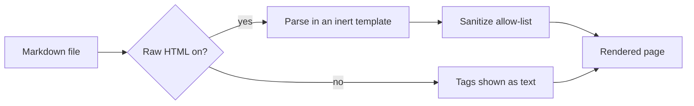
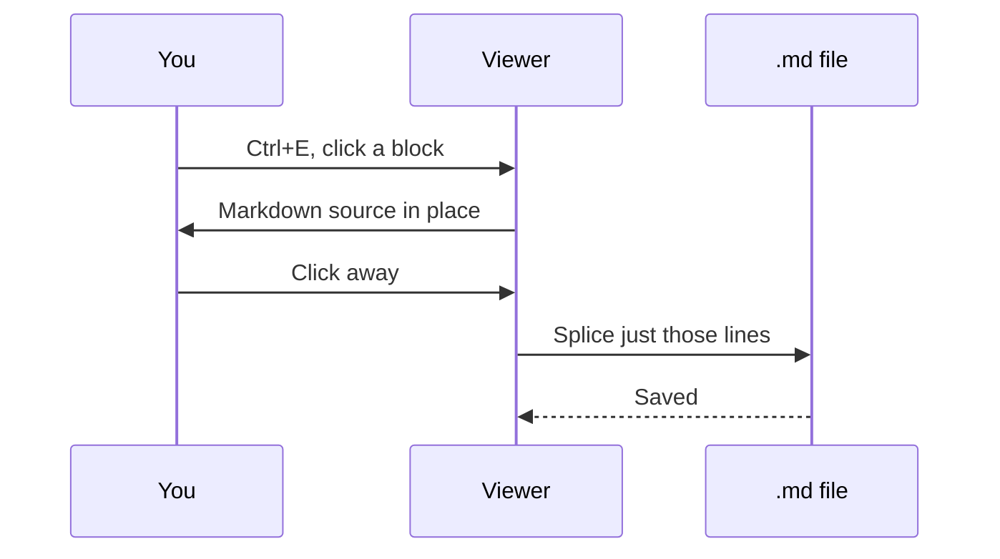
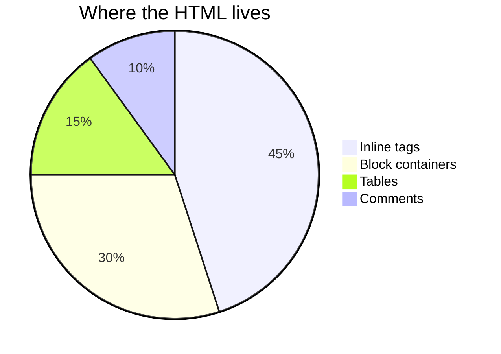

# Raw HTML Test

Everything people put in Markdown files as raw HTML, one item at a time. Each
item says what you should see — the target is how GitHub renders it, since
that's what most authors check their files against.

Raw HTML is **on by default**. If tags below show up as literal text, the
toggle got turned off (⋮ → Allow raw HTML). Sections 2, 3 and 15 should look
right either way.

Remote images come from placehold.co and shields.io, so they need a network
connection.

---

## 1. Inline formatting

Plain markdown **bold** next to <b>tag bold</b>, <strong>strong</strong>, <i>italic</i>,
<em>em</em>, <u>underline</u>, <mark>marked</mark>, <s>struck</s>, <del>deleted</del>,
<ins>inserted</ins>, <small>small</small>, and <big>big</big>.

<sub>sub</sub> / <sup>sup</sup> · H<sub>2</sub>O · E = mc<sup>2</sup>

<kbd>Ctrl</kbd>+<kbd>Shift</kbd>+<kbd>P</kbd> · <code>inline code tag</code> ·
<samp>sample output</samp> · <var>variable</var>

<abbr title="HyperText Markup Language">HTML</abbr> (hover for title) ·
<dfn>definition term</dfn> · <q>inline quote</q> · <cite>Cited Work</cite>

<time datetime="2026-10-10">October 10</time> · <data value="42">forty-two</data> ·
<ruby>漢<rt>kan</rt>字<rt>ji</rt></ruby> · <bdo dir="rtl">reversed text</bdo>

A very long word that may break here: super<wbr>cali<wbr>fragilistic<wbr>expialidocious.

*Expect: each tag styled as named, all in normal paragraphs — no literal tags.*

## 2. Line breaks

Line one.<br>Line two via `<br>`.

Line one.<br/>Line two via `<br/>`.

Line one.<br />Line two via `<br />`.

Line one.</br>Line two via `</br>` (not real HTML, but common).

Escaped: \<br> stays as text, and `<br>` inside a code span stays as text.

| Table cell | With a break |
|---|---|
| first line<br>second line | a<br/>b<br/>c |

*Expect: every pair on two lines; the escaped and code-span ones literal; table
cells broken onto multiple lines. These work even with raw HTML off.*

## 3. Entities

Named: &copy; &reg; &trade; &mdash; &ndash; &hellip; &laquo;quotes&raquo; &larr; &rarr; &hearts;

Numeric: &#169; &#8212; &#124; · Hex: &#xA9; &#x2014; &#x7C;

Spacing: A&nbsp;&nbsp;&nbsp;B (three non-breaking spaces) · A&emsp;B (em space)

Escaped ampersand: Fish &amp; Chips · bare ampersand: Fish & Chips

Not an entity: &notanentity; and AT&T stay as typed.

In a code span the entity stays literal: `&copy;`

*Expect: symbols, not `&copy;` text — except the last two lines, which show as
written. These work even with raw HTML off.*

## 4. Inline styles

<span style="color: crimson">This should be red.</span>   
<span style="background: gold; padding: 2px 6px; border-radius: 3px">Gold pill.</span>

<div style="border-left: 4px solid teal; padding: 8px 12px; margin: 12px 0">
A bordered callout built with a styled div.
</div>

<p style="text-align: right; font-style: italic">Right-aligned, italic paragraph.</p>

*Expect: red text, then a gold pill on the next line (trailing spaces = line
break); a teal-bordered box; a right-aligned italic line.*

## 5. Links and anchors

<a href="https://example.com" target="_blank" rel="noopener">Opens in a new tab</a>

<a href="mailto:someone@example.com">Mail link</a>

<a name="custom-anchor"></a>Named anchor here — <a href="#custom-anchor">jump to it</a>.

<a href="javascript:alert('xss')">This href should be neutered</a>

<a href="#5-links-and-anchors"><b>Bold</b> link with <i>mixed</i> content</a>

*Expect: five working-looking links; the javascript one does nothing when clicked.*

## 6. Images

 ← 48px tall via `height`

 ← 200px wide via `width`


Text that should flow to the left of a right-aligned image. It keeps going for
a bit so you can see the wrap behaviour beside the floated picture.

<a href="https://example.com"></a> ← an image that is a link

<picture>
  <source media="(min-width: 1px)" srcset="https://placehold.co/160x60/png?text=picture">
  
</picture>


*Expect: sizes as labelled; the floated image on the right with text beside it;
"picture" (not "fallback"); a broken-image marker with alt text.*

## 7. README header patterns

<div align="center">
  
  <h3 align="center">Project Name</h3>
  <p>An awesome thing &mdash; built with care.</p>
</div>

<p align="center">
  <a href="https://example.com"></a>&nbsp;<a href="https://example.com"></a>&nbsp;<a href="https://example.com"></a>
</p>

<h1 align="center">An HTML h1, centered</h1>

<p align="center">
  <a href="#1-inline-formatting">Docs</a> ·
  <a href="#6-images">Images</a> ·
  <a href="#9-tables">Tables</a>
</p>

*Expect: a centered 64px logo, title and tagline; three badges side by side
on one line; a centered big heading; a centered nav row. (HTML headings don't
appear in the Contents sidebar — only Markdown ones do.)*

## 8. Block containers with Markdown inside

<div style="border: 1px dashed gray; padding: 4px 12px">

This div has **Markdown inside it**, separated by blank lines:

- a list item
- another, with `code`

</div>

<blockquote>
  An HTML blockquote.
</blockquote>

<center>Centered via the legacy center tag.</center>

<div>
This line touches the div tag, so **these asterisks stay literal** — that's
GitHub's rule too: Markdown only works inside HTML after a blank line.
</div>

*Expect: a dashed box containing bold text and a real bulleted list; a styled
blockquote; centered text; literal asterisks in the last box.*

## 9. Tables

<table border="1" cellpadding="6" cellspacing="0">
  <caption>Legacy attributes, with a caption</caption>
  <thead>
    <tr><th>Region</th><th align="right">Revenue</th><th>Status</th></tr>
  </thead>
  <tbody>
    <tr><td>North</td><td align="right">5200</td><td>Closed</td></tr>
    <tr><td>South</td><td align="right">3100</td><td>Open</td></tr>
    <tr><td>East</td><td align="right" bgcolor="#fff3cd">7400</td><td>Closed</td></tr>
  </tbody>
</table>

<table>
  <tr><th colspan="2">Spans two columns</th><th>C</th></tr>
  <tr><td rowspan="2">Spans two rows</td><td>b1</td><td>c1</td></tr>
  <tr><td>b2</td><td>c2</td></tr>
</table>

<table>
  <tr>
    <td align="center"><br><sub><b>Alice</b></sub></td>
    <td align="center"><br><sub><b>Bob</b></sub></td>
    <td align="center"><br><sub><b>Chen</b></sub></td>
  </tr>
</table>

| Markdown table | with HTML in cells |
|---|---|
| <b>bold tag</b> | <span style="color: crimson">red span</span> |
| <kbd>Esc</kbd> |  |

*Expect: a captioned table with right-aligned numbers and one yellow cell; a
spanning table; a contributor grid of three avatars with names; a Markdown
table rendering HTML in its cells. Only the Markdown table gets the
Interactive Mode bar — HTML tables are usually layout.*

## 10. Lists

<ul>
  <li>HTML list item</li>
  <li>With a nested list
    <ul><li>nested item</li></ul>
  </li>
</ul>

<ol start="5">
  <li>starts at five</li>
  <li>six</li>
</ol>

<ol reversed>
  <li>counts</li>
  <li>down</li>
</ol>

<dl>
  <dt>Term</dt><dd>Definition of the term.</dd>
  <dt>Another</dt><dd>Second definition.</dd>
</dl>

- Markdown list item with <b>inline HTML</b> and <kbd>Ctrl</kbd>
- Item with a <br>break inside

*Expect: nested bullets; 5–6; 2–1 counting down; a definition list; inline
HTML inside Markdown list items.*

## 11. Details / summary

<details>
  <summary>Plain — click to expand</summary>
  Hidden content revealed on toggle.
</details>

<details open>
  <summary>Starts open</summary>
  Visible without clicking.
</details>

<details>
<summary>With <b>Markdown</b> inside</summary>

- a real list
- with **bold**

```js
const insideDetails = true;
```

</details>

<details>
  <summary>Nested</summary>
  <details>
    <summary>Inner</summary>
    Inner content.
  </details>
</details>

*Expect: four disclosure triangles; the second already open; the third, when
opened, shows a bulleted list and a highlighted code block.*

## 12. Preformatted and code

<pre>
pre keeps its

blank line, and    spacing
</pre>

<pre><code>&lt;div&gt; escaped markup inside pre/code &lt;/div&gt;
second line</code></pre>

*Expect: monospace blocks; the first keeps the empty line and the run of
spaces; the second shows `<div>` as text.*

## 13. Mixed Markdown and HTML

<b>Note:</b> this line starts with a tag, yet **this is bold** and [this is a link](https://example.com).

A wrapped paragraph whose second line
<a href="https://example.com">starts with a link</a> stays one paragraph.

A <b>bold run that wraps
onto the next line</b> inside a paragraph.

> <b>Blockquote</b> with inline HTML and **Markdown** together.

### Heading with a badge <sup>beta</sup>

<DIV style="color: teal">Uppercase tag names work too.</DIV>

*Expect: bold and link working on the first line; the second and third each
one paragraph; a quote with both kinds of bold; a heading with a superscript
(listed in Contents); teal text.*

## 14. Media

<video controls width="320" poster="">
  <source src="nonexistent.mp4" type="video/mp4">
  Fallback text if video is unsupported.
</video>

<audio controls>
  <source src="nonexistent.mp3" type="audio/mpeg">
  Fallback text if audio is unsupported.
</audio>

*Expect: a video player and an audio player (nothing to play — the files don't exist).*

## 15. Comments

Text before <!-- an inline comment --> text after, on one line.

<!-- A single-line comment on its own. -->

<!--
  A comment spanning blank lines.

  None of this should show, and everything after it must still render.
-->

<!-- comment --> Text right after a comment on the same line.

*Expect: "Text before text after", then "Text right after a comment…" — no
comment text anywhere, and this section's Expect line (plus everything below)
still showing.*

## 16. Mermaid diagrams

Not HTML, but it shares the render path, so it lives here too.





<details>
<summary>A diagram inside a details block</summary>



</details>

**Deliberately broken diagram** — the error box below is the expected result.
It checks that bad Mermaid syntax shows a readable error instead of breaking the page:

```mermaid
flowchart TD
    this is not valid mermaid syntax -->
```

*Expect: a left-to-right flowchart; a sequence diagram; a pie chart when the
details block is opened; a readable "Mermaid error" box for the last one —
and all of them re-theme when you switch light/dark (press D).*

## 17. Semantic sectioning

<article>
  <header><strong>Article header</strong></header>
  <p>Body inside an article element.</p>
  <footer><small>Article footer</small></footer>
</article>

<aside style="opacity: .8">Aside content.</aside>

<nav><a href="#1-inline-formatting">Jump to section 1</a></nav>

<main><p>Main element content.</p></main>

<section><h4>Section heading</h4><p>Section body.</p></section>

<figure>
  
  <figcaption>A figure caption.</figcaption>
</figure>

<address>Written by A. Person, example.com</address>

*Expect: each renders as plain content blocks; the figure shows its caption.*

## 18. Legacy presentation

<font color="purple" size="5">Purple, size 5.</font>

<font face="Georgia, serif" color="#0a7">Georgia, green.</font>

<big>big</big> / <small>small</small> / <strike>strike</strike> / <tt>teletype</tt>

<hr>

<p align="justify">A justified paragraph using the old align attribute. It needs to be long enough to wrap so that justification is visible, so here is some more text to make it wrap across lines.</p>

*Expect: purple large text; green serif text; the four styles; a rule; a
justified paragraph.*

## 19. Accessibility attributes

<div role="note" aria-label="Accessible note">
  Should keep both role and aria-label.
</div>

<span title="Tooltip text" lang="fr" dir="ltr">Bonjour (hover for a tooltip)</span>

*Expect: plain text; the attributes survive (check with the inspector).*

## 20. Things that MUST be stripped

If any of the following execute or appear, the sanitizer has a hole.

<script>document.title = "XSS FIRED";</script>

<style>body { background: red !important; }</style>

<iframe src="https://example.com" width="300" height="150"></iframe>

<div onclick="alert('inline handler')">Clicking this should do nothing.</div>


<a href="javascript:void(document.title='LINK XSS')">Neutered link text stays</a>


<form><input type="text" value="form input"><button>Submit</button></form>

<svg width="50" height="50"><circle cx="25" cy="25" r="20" fill="red"/></svg>

<object data="test.swf"></object>
<embed src="test.swf">

<meta http-equiv="refresh" content="0; url=https://example.com">

<base href="https://evil.example/">

<link rel="stylesheet" href="https://evil.example/x.css">

*Expect: only "Clicking this should do nothing.", the two alt texts, and
"Neutered link text stays" are visible. No red page, no frame, no form, no
circle, no redirect, page title unchanged, no alerts.*

---

**Done.** If everything above matched its Expect line, raw HTML is in good shape.
